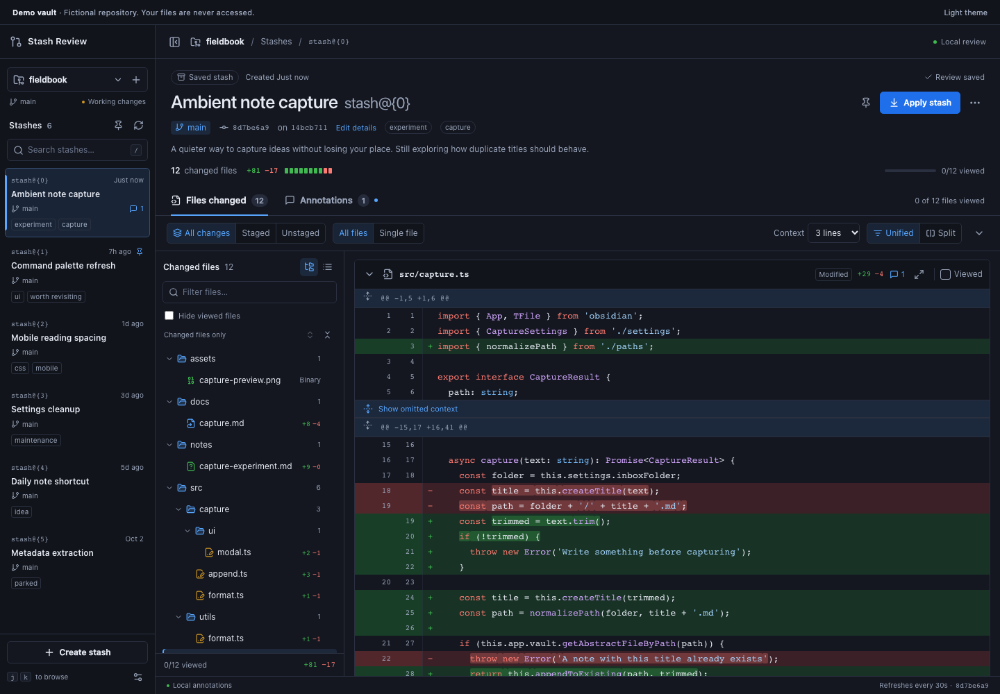

# Stash Review

A pull request workspace for the changes you have parked in Git stashes. Open it in Obsidian, give each stash a useful title, and read the code with enough context to pick up where you left off.



The screenshots use the fictional browser Demo vault. [Laptop layout](docs/images/stash-review-laptop.png) · [Markdown embed](docs/images/stash-review-embed.png) · [Light theme](docs/images/stash-review-light.png) · [Single file](docs/images/stash-review-focused.png) · [Split diff](docs/images/stash-review-split.png) · [Filtered tree](docs/images/stash-review-tree.png) · [Narrow workspace](docs/images/stash-review-narrow.png).

Stash Review runs on **Obsidian desktop 1.6 or later**, with Git installed on your computer. Your vault can be the repository, or you can review any other local Git repository from the same vault.

- Search stashes by their message, review title, description, or tags; pin the ones you want to revisit.
- Browse a collapsible folder tree of changed files, with directory review progress, change status, line counts, and a flat-list option. Search keeps matching files inside their folder hierarchy.
- Read syntax-highlighted unified or side-by-side diffs with line numbers, full-file context, and separate staged and unstaged layers. Choose all files together or one file at a time.
- Annotate a line or range, reply to a thread, resolve questions, and mark files reviewed.
- Create a stash, apply a saved stash with an optional index restore, remove a stash with a recoverable backup, or export your review to a Markdown note.
- Keep titles, tags, notes, and review progress across restarts and stash renumbering.
- Link to an exact stash from an Obsidian note, or embed an interactive review directly in Markdown.
- Reopen archived reviews and recover dropped stashes after restarting Obsidian.
- Track Viewed progress separately in All changes, Staged, and Unstaged; search saved diff text and hide whitespace noise.
- Relocate repositories without changing review links, or import/export portable review packages for offline reading.

## Install

Download **`stash-review-0.2.0.zip`** from the [latest GitHub release](https://github.com/Nielk74/obsidian-stash-review/releases/latest). Extract the `stash-review` folder into:

```text
YOUR_VAULT/.obsidian/plugins/stash-review/
  main.js
  manifest.json
  styles.css
```

In Obsidian, open **Settings → Community plugins**, enable community plugins if needed, and enable **Stash Review**. Use the Git pull request ribbon icon or run **Stash Review: Open stash review** from the command palette.

To update an existing installation, replace only `main.js`, `manifest.json`, and `styles.css`, then disable and enable Stash Review. Keep `data.json` and the `reviews/` directory in place to preserve your annotations, titles, tags, progress, and captured code.

You can also install through [BRAT](https://github.com/TfTHacker/obsidian42-brat): add `Nielk74/obsidian-stash-review` as a beta plugin. This plugin is distributed through GitHub releases; it is not yet listed in Obsidian's community plugin directory. Release assets include the individual plugin files and `SHA256SUMS` for checksum verification.

## Use it

If your vault is in a Git repository, the plugin discovers it when no other repositories are configured. Otherwise, add an absolute repository folder path in the review workspace or in **Settings → Stash Review → Repositories**. Configure an absolute Git executable path if Obsidian cannot find `git`, such as `/opt/homebrew/bin/git` on an Apple Silicon Mac.

Choose a stash and give it a title that explains the idea. Add a short description and tags; these change your review metadata and preserve the original Git stash message. Switch between **All changes**, **Staged**, and **Unstaged** to see what was in the index and working tree when the stash was made. Captured untracked files appear in the appropriate saved working-tree view. Binary files display their status instead of a text diff.

The **Files changed** sidebar shows changed paths in their actual folder hierarchy. Folders come before files at each level; files with the same name keep their own path and review state. Expand or collapse folders, or switch between **Tree** and **List**. Search shows matching paths with their ancestors expanded, then restores your folder choices when you clear it. Folder choices survive reopening the workspace.

Choose **All files** for a continuous review, or **Single file** to focus on the selected path. The file tree stays available in either mode, and the previous/next controls move between matching files. Collapse individual diffs or all files when you want to scan headers. Marking a file **Viewed** collapses its diff and updates progress in its parent folders. **Hide viewed files** filters the completed files while retaining your annotations and progress.

Viewed flags belong to the selected diff layer. Reviewing a file in **Staged** does not mark its **Unstaged** or **All changes** version reviewed. Existing progress from earlier plugin versions becomes All changes progress; existing comments retain their original layer.

**Find in changes** searches the selected layer's captured diff text, including its displayed context, with literal case-insensitive matching. It does not read every full file or run Git as you type. Enter moves to the next result, Shift+Enter to the previous, and Escape clears the query. The first 200 matches are highlighted; navigation reaches later results directly. The annotation panel also searches comment bodies, replies, and paths. Search waits 100 ms after typing and reuses its index.

**Ignore whitespace** hides equivalent whitespace changes in the displayed diff. Saved code, line numbers, annotations, totals, and Viewed flags retain their original meaning. Navigating to a search result or an annotation restores the unfiltered presentation so its original code remains visible. Save or cancel a new annotation before navigating search results or changing whitespace presentation.

Use a line's comment control to leave a note. Select a range with Shift when you want to discuss several lines. Threads belong to a specific file, line side, and diff layer. Selecting an annotation's location returns to its saved layer, reveals its file even when filtered or collapsed, and shows the original anchor. Expand file context to read surrounding saved code, then export the discussion into your vault when you want a standalone note.

On a laptop or in a narrow Obsidian pane, the stash list and file tree open as drawers so code can use the available width. Close them with Escape or by clicking outside. Short panes collapse secondary stash details; **Show stash details** reveals the description, tags, and capture information. **Wrap code lines** avoids horizontal scrolling in a unified diff. Select code text normally to copy it without diff signs or line numbers; in split view, copying a vertical selection keeps the selected side. A file header's copy button copies the full saved file, or its original contents for a deleted file.

## Link or embed a review in a note

Open **More stash actions → Copy Markdown link**, then paste into any Obsidian note. Clicking the link opens the review tab at that exact repository, stash, and diff layer. In **Single file** mode the link also remembers the selected path. Links use the full stash commit hash, so creating or removing other stashes cannot redirect them to a different `stash@{n}`.

Choose **Copy Markdown embed** to paste an interactive review inside the note instead. This copies a fenced `stash-review` block containing the same URL. The block renders in Reading view and rendered Live Preview blocks, with file navigation, diffs, annotations, and viewed-file controls. **Open full review** opens that snapshot in the plugin tab. Embeds and tabs share review metadata, including edits made while another view is saving.

For a manually written block, use `repo: <repository ID>` and `stash: <full commit hash>` on separate lines. Optional fields are `layer: all`, `staged`, or `unstaged`, and `file: <path>`. Copying the link or embed is easier because it supplies the correct identifiers. An invalid definition displays an explanation; an unavailable stash or file never silently opens a different target.

Links refer to a stable review repository ID and the full stash hash in the named vault. **Relocate** in the sidebar, or **Settings → Stash Review → Relocate**, binds that ID to a new local folder after a move or clone. Existing links and notes keep their identity. Archived links reopen their exact saved review; unavailable code is explained without selecting a different stash.

Descriptions, annotation bodies, and replies support Obsidian Markdown, wiki links, lists, and fenced code. Embedded reviews use their containing note's path for relative links and attachments. Rendered threads release their Obsidian components when closed. Markdown exports include provenance, progress for each layer, and original annotated code excerpts where available. A missing excerpt is stated beside its discussion.

Within the file tree, use **↑/↓** to move, **→/←** to expand or collapse a folder and move between parents and children, **Home/End** to reach the first or last item, and **Enter/Space** to open a file. Stash shortcuts **j/k** continue to work in the stash list; file navigation and text fields keep their own keyboard behavior.

The review layout follows the compact diff headers, viewed-file controls, and folder navigation documented by [GitHub](https://docs.github.com/en/pull-requests/how-tos/review-pull-requests/reviewing-proposed-changes-in-a-pull-request) and [Bitbucket](https://support.atlassian.com/bitbucket-cloud/docs/review-code-in-a-pull-request/), including Bitbucket's choice of all-file and individual-file review.

Applying requires a clean working tree and preserves the saved stash. You can choose whether to restore the original index. If Git reports a conflict, inspect and resolve the working tree before trying again; Git can leave partially applied files. Creating a stash can include untracked files when selected. Ignored files are excluded.

When your vault is the repository, the running plugin's installation folder and review data stay in place. Creating a stash excludes that folder. If protected plugin files are staged, creation and application stop before changing the repository and ask you to unstage them. Applying ignores unstaged and untracked changes within that protected folder when checking for a clean tree, and refuses a stash that contains changes to those plugin files. All other local changes still block application. Adding `.obsidian/plugins/stash-review/` to your vault repository's `.gitignore` keeps generated plugin files and review data out of future commits; use your configured vault folder name if it differs from `.obsidian`.

Removing a stash asks for confirmation. Before removal, the plugin creates a Git reference at **`refs/stash-review/backups/<stash-hash>`** so Git retains the object. Opening a review also retains its original stash at **`refs/stash-review/reviews/<stash-hash>`**. These references remain until you remove them yourself. The workspace offers Undo, and **Archived reviews → More stash actions → Restore stash** recovers a retained stash after restarting. To find retained objects and recover one manually:

```sh
git for-each-ref refs/stash-review/backups/
git for-each-ref refs/stash-review/reviews/
git stash store -m "Recovered stash" refs/stash-review/backups/STASH_HASH
```

Use **Archive review** to remove a review from Active without dropping its Git stash, and **Restore to Active** to reverse that choice. The archive browser also discovers retained drops, missing stashes with saved notes, and legacy backup references. It shows 50 entries per page and loads code only for the selected review. Missing layers or uncaptured full source remain explicitly unavailable while notes remain editable.

If you replace a stash with revised contents, its new hash starts a separate review. Open **More stash actions → Continue from previous review** and choose the original archived review explicitly. Notes and Viewed flags transfer only for exact path, blob, mode, and rename matches in their own layer, verified against Git. Changed or unverifiable files keep their discussions on the original snapshot. The new review links back to that original. Reused `stash@{n}` values and similar messages never trigger an automatic transfer.

**Export review data** downloads a versioned JSON package with notes and all three captured diff layers. **Import review data** accepts that package into the saved library or an explicitly selected local repository. Import validates paths, identities, coordinates, annotated excerpts against available source, and a 32 MiB uncompressed package limit before committing metadata. Identical imports are deduplicated; conflicting local notes or captured code are rejected. A failed import removes its uncommitted snapshots before another attempt can use them. Import does not create, apply, or drop Git stashes. Offline reviews support reading and annotation; Git mutations require the local repository and appropriate retained objects. Full-file context is included only when it was captured; diff hunks remain available independently.

The initial repository ID comes from its common Git directory and is saved as a stable binding, so notes survive stash renumbering and remain consistent across linked worktrees and explicit relocation. Settings, bindings, and review metadata live in **`.obsidian/plugins/stash-review/data.json`**. Captured layers live as atomically written compressed JSON under **`.obsidian/plugins/stash-review/reviews/`**, with a 32 MiB uncompressed limit per layer. Use the corresponding path under a custom vault configuration folder. Back up both locations. Vault sync can copy saved code from external repositories as well as notes. The plugin itself sends no repository contents or annotations to a server; Git operations use the configured local executable.

Git operations from plugin tabs are serialized across linked worktrees. Other Git programs can still change the stash list. The plugin rechecks stash identity before removal and verifies the result afterward; if it detects an unexpected removal, it preserves a backup reference and reports the concurrent change. Refresh the list before continuing.

## Develop and preview

Use Node.js 22 and Git:

```sh
npm ci
npm run build
npm test
npm run test:package
npx playwright install chromium
npm run test:e2e
```

`npm run dev` rebuilds the desktop plugin while you work. Copy the built `main.js`, `manifest.json`, and `styles.css` into a test vault's plugin folder to load it in Obsidian.

`npm run preview` serves the same React review workspace at `http://127.0.0.1:4173`. It uses a clearly marked **Demo vault** with fictional Git snapshots. Demo mutations and annotations persist in browser localStorage; the preview never reads or changes your local repositories. Clear that site's storage to reset it. Add `?theme=light` for a light theme, or `?state=empty`, `?state=error`, and `?state=diff-error` to inspect fallback screens.

To preview a review embedded in a note, use `?embed=1&repo=demo-fieldbook&stash=8d7be6a901afe7794ed9a6f1a3cb0318409876da`; `embed=2` shows two instances sharing metadata. The optional `layer` and `file` parameters select a saved layer and path. The workspace caches syntax output within a bounded memory budget, skips highlighting collapsed files, and keeps very large generated files readable as plain code to avoid expensive tokenization.

The test suite creates isolated temporary Git repositories to verify diff layers, stash identity, untracked files, mutation guards, and backup recovery. Browser tests exercise the review workflow and save screenshots as test artifacts. A package smoke test loads the compiled plugin against a minimal Obsidian API contract to check registration, persistence, and vault export. CI runs these checks before packaging a release. A native Obsidian GUI smoke test remains unverified on the headless development host.

Run the performance audit separately from tests so other workloads do not distort timings:

```sh
npm run benchmark -- --output benchmarks/results/latest.json
npm run benchmark -- --ref 0985990 --output benchmarks/results/baseline.json
npm run benchmark -- --section browser --cpu 4 --viewport 1366x768 --samples 9
```

The audit measures production UI rendering and interactions, real Git reads and mutations in a disposable repository, plugin initialization and persistence, syntax and parsing, memory, and embed cleanup. Browser workloads cover ordinary reviews, 1,000 files/stashes/annotations, sparse 20,000-line files, dense 5,000-line changes, and six embeds. Each JSON report includes hardware, source hashes, raw samples, median, p95, long tasks, and explicit timing targets. `--section compute|git|browser`, `--workloads typical,multi-embed`, and `--cpu 1,4` select subsets. A revision comparison reads committed sources without changing the checkout. Git mutations stay inside the verified temporary fixture directory.

Browser timings use a deterministic in-memory host to isolate rendering; real Git and the native plugin host are measured separately. CPU throttling approximates a slower machine, fresh pages/services retain operating-system disk caches, and single-sample actions do not establish a meaningful p95. These measurements do not replace testing inside Obsidian on the target laptop.

Large diffs mount nearby files and row groups first, retaining them once visited to preserve selections and edits. Clipboard selection reconstructs intervening unloaded code from the snapshot. Identical reads across embeds share pending requests; immutable diff/source results use a bounded 16 MiB cache, while repository and stash lists remain fresh on refresh.

Durable reviews use a 32-entry shared cache and 200-row rendering chunks. Search builds its index only when a query exists; source hydration and whitespace toggles reuse the canonical snapshot. Archive summaries avoid copying all annotation bodies. Run the additional audit with:

```sh
node --expose-gc scripts/benchmark-durable-reviews.mjs --samples 5
node --expose-gc scripts/benchmark-durable-reviews.mjs --compare-existing --section browser --samples 5 --cpu 1 --workloads typical,many-files,dense-large-file,multi-embed --output benchmarks/results/comparison.json
```

The comparison mode runs the supplied audit with five samples for its otherwise capped heavy workloads, leaving the original script unchanged. Focused reports cover archive paging, layer progress, search, whitespace, relocation, portable round trips, continuation, read coalescing, and repeated Markdown/UI mount cleanup. See [durable review performance](benchmarks/durable-reviews-performance.md) for measurements and their limits.

### Earlier performance audit, 2026-10-12

These measurements cover the completed performance work before the durable-review additions. The durable-review report above measures the combined feature workflows separately.

The [complete optimized audit](benchmarks/results/optimized.json) records 469 cases and 2,527 timing samples on Windows 11, a Ryzen 7 9800X3D, and 31.1 GiB RAM. The baseline is commit `0985990`; browser comparisons below use the same fixtures at 1440×900 without CPU throttling. These are rendering timings with an in-memory host, except the explicitly named Git reads.

| Operation | Before | After |
| --- | ---: | ---: |
| Open a 1,000-file review | 1,465 ms | 127 ms |
| Switch a dense 5,000-line change to split view | 3,181 ms | 33 ms |
| Expand full context in a 20,000-line file (one sample) | 1,716 ms | 51 ms |
| Open the tab containing 1,000 annotations | 163 ms | 35 ms |
| Cold formatting of 180,000 source characters | 38.8 ms | 1.2 ms |
| Six simultaneous native-host reads of the same diff | 2,463 ms | 599 ms |
| Six simultaneous native-host reads of the same source | 2,514 ms | 368 ms |

Times are medians unless marked as one sample. Formatting above 100,000 source characters uses escaped plain code. Source reports: [compute baseline](benchmarks/results/baseline-compute.json), [Git baseline](benchmarks/results/baseline-git.json), [browser baseline](benchmarks/results/baseline-browser-final.json), and the earlier [4× CPU baseline](benchmarks/results/baseline-browser-4x.json), whose matrix contains fewer actions.

All 206 unthrottled browser cases meet their recorded targets. With a 4× CPU slowdown, 18 of 206 browser cases exceed their targets: some large navigator/layer changes and wrapping after visiting every row still take hundreds of milliseconds. Cold native Git reads also retain several target misses, including a 700 ms p95 for the 120-file combined diff. A separate [1366×768 laptop viewport report](benchmarks/results/laptop.json) uses the same 4× slowdown and records 118 cases, 423 samples, and 12 target misses. Both browser reports contain zero runtime errors. The reports retain every miss; these results do not establish that every operation is instant on a physical laptop.

The long-session check visits every group in the dense diff before repeating wrapping and annotation edits. Twelve six-embed mount/unmount cycles leave zero metadata listeners after each unmount and show 0.11 MiB of retained heap growth after collection. This is a bounded lifecycle check, not a guarantee against every possible leak.

For a release, update `package.json`, `manifest.json`, and `versions.json`, then push an annotated version tag such as `0.2.0`. The release workflow builds, tests, packages the plugin folder, and publishes assets using the GitHub CLI. Obsidian version tags have no `v` prefix.

MIT licensed.
